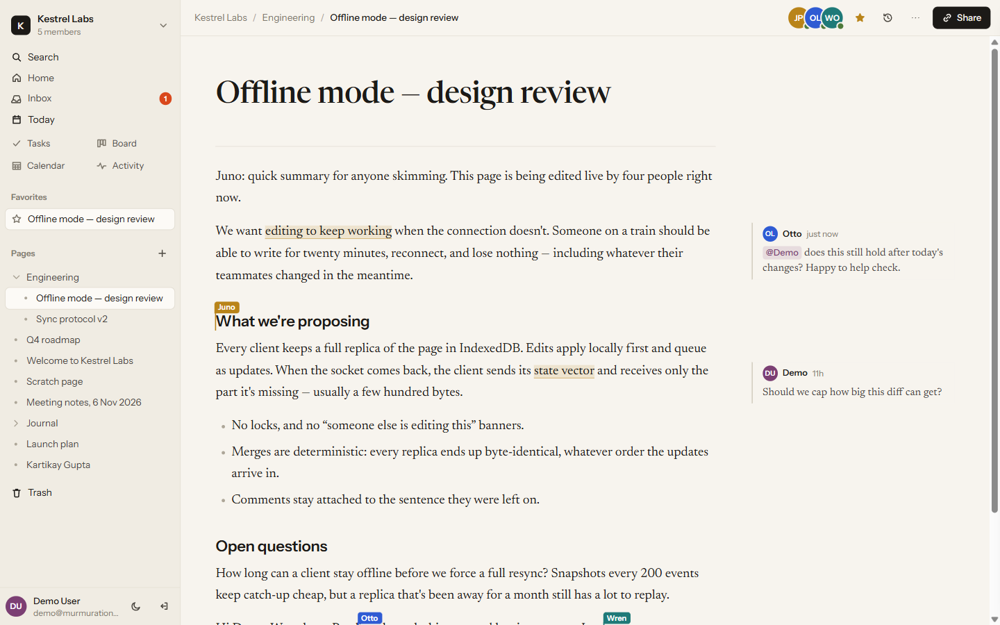
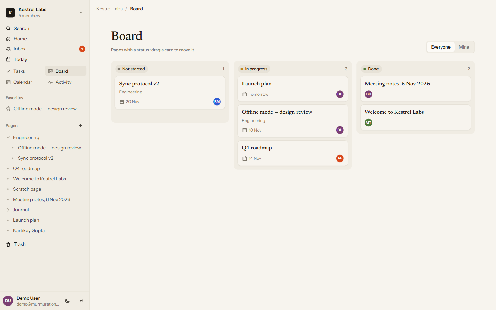
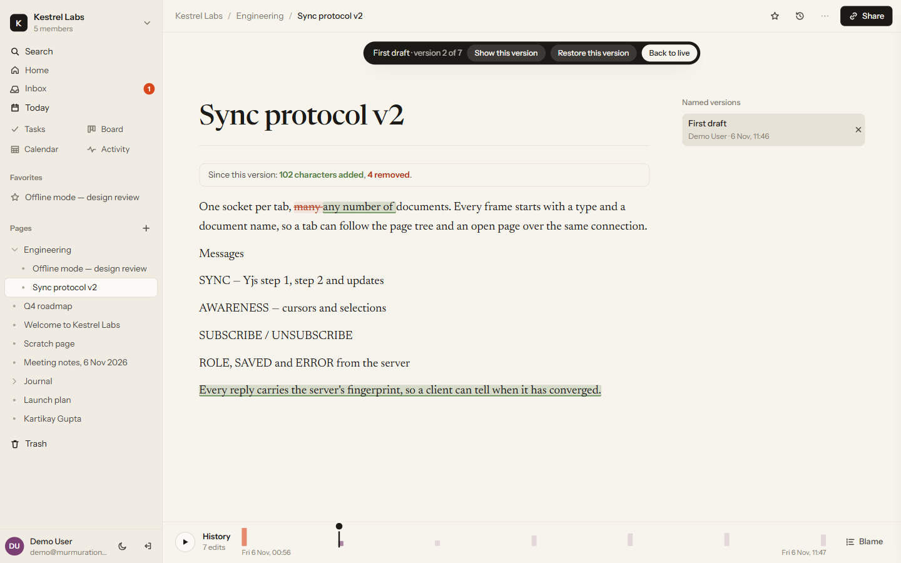
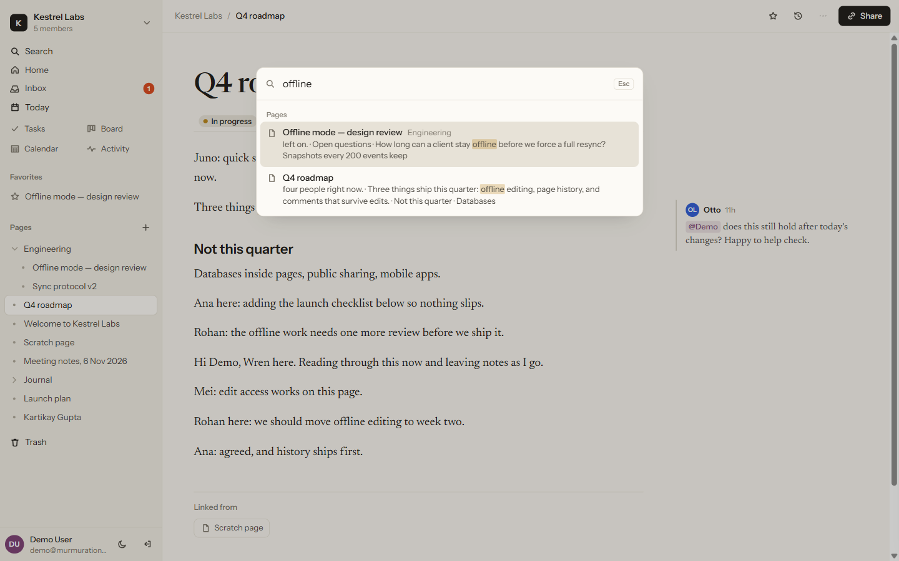
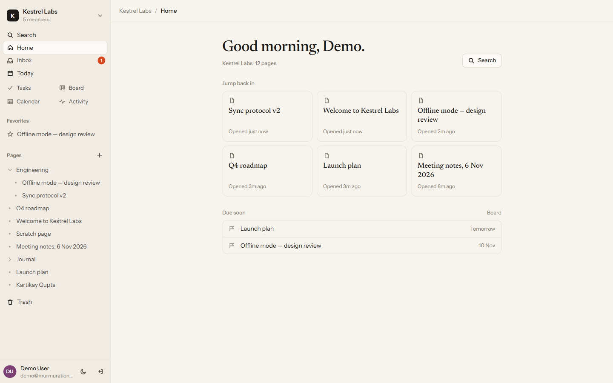

# Murmuration

**A real-time collaborative workspace with its own sync engine.** Many people write the same page at once, work offline, and every copy ends up identical, with every edit kept, attributed and replayable.

[](https://github.com/kartikay633/Murmuration/actions/workflows/ci.yml)
[](https://murmuration-t806.onrender.com)




> Thousands of starlings move as one shape with no leader. Murmuration's pages work the same way: every browser keeps its own copy, edits merge without locks, and no server ever has to decide who wins.

## Try it

**[murmuration-t806.onrender.com](https://murmuration-t806.onrender.com)**: click **Try the live demo** for a private sandbox, no sign-up.

1. Open the **⋯** menu on a page, choose **Network Lab**, and **invite the practice collaborators**. Three scripted people join over the real protocol: they type at the top and bottom of the page at once, move their cursors and @mention you in a comment.
2. In the Network Lab, switch your connection **off**, keep typing, switch it back on, and watch the copies merge and their fingerprints match.
3. Press **Ctrl/⌘+K** to search everything, or open the **clock** to replay the page and compare any version with today.

*Free hosting: the first visit after a quiet spell can take up to a minute while the server wakes.*

## Engineering highlights

- **A sync server written from scratch.** One WebSocket per tab carries any number of documents over a small binary protocol. Every edit is checked against the sender's role **on the server**; a role change reaches open connections within seconds. Text merging uses the [Yjs](https://github.com/yjs/yjs) CRDT; the protocol, server, persistence, permissions and client are this project's.
- **An append-only event log.** Every update is stored with its author; a document loads as *latest snapshot + events after it*. The log powers time travel, restore, per-character authorship ("who wrote what") and a **word-level diff between any two versions** (Myers' O(ND) algorithm, in [`packages/shared/src/diff.ts`](packages/shared/src/diff.ts)).
- **A CRDT for the page tree.** Two people dragging pages at once can never create a cycle: moves go into a shared log ordered by Lamport timestamps, and every replica replays it the same way, skipping any move that would put a page inside itself (after Kleppmann et al.). Checked by a fuzz test of 10,000 random concurrent moves.
- **Offline-first.** Pages are cached in IndexedDB; offline edits merge on reconnect. The header says *Saved* only once the server has acknowledged every edit (`SAVED(n)` means frames 1..n are stored).
- **Catch-up from CRDT ids.** When you open a page, text others wrote since your last visit is highlighted in their colour. The highlights come from decoding the Yjs updates you missed into item ids, so they stay on the right words while people keep typing.
- **Horizontal scaling.** Any number of sync servers run side by side behind **Redis**; Postgres `LISTEN/NOTIFY` pushes comments, mentions and reminders to the right sockets live. 200 clients across two servers: **p50 11.9 ms** delivery, every copy identical within 0.55 s ([details](#performance)).

## Features

| | |
|---|---|
|  **Board**: give pages a status, owner and due date; drag between columns. |  **History**: replay, blame, named versions and word-level diffs. |
|  **Search**: Postgres full-text search over every page, with excerpts. |  **Home**: where you were, what changed, what's due. |

**Writing.** `/` for headings, to-dos, tables (sortable), toggles, callouts, code and dividers · `[[` links pages, with backlinks on every page · `@` mentions a teammate · templates, including your own · Markdown import and export · present any page as slides · focus mode and an outline for long pages.

**Working together.** Live cursors and presence · comments anchored to text that survive edits around them · follow a teammate's cursor across pages · catch-up highlights and "changed since you looked" dots · read receipts · an inbox for mentions, replies and reminders · a live task list built from to-dos across all pages (tick them off from there) · weekly activity.

**Organising and control.** Nested pages with drag and drop · workspace home, board, calendar and a shared daily journal · favorites, recents and a trash · roles from owner to viewer, overridable per page · locked pages · publish a page to a public read-only link · export a workspace as a `.zip` of Markdown.

## Architecture

```
Browser (Next.js, React, Tiptap)           Sync server (Node, ws)                  PostgreSQL
 Y.Doc per open page ──┐                    ┌─ token check on the first frame
 Y.Doc for the tree ───┼── one WebSocket ───┼─ role check on every edit      ──▶   doc_events (append-only, per author)
 IndexedDB cache ──────┘   many documents   ├─ presence ownership check            doc_snapshots (every 200 events)
                                            ├─ batched writes, SAVED(n) acks       pages, roles, comments, tasks, links…
                                            └─ mirrors text, links, tasks  ──▶     search index, backlinks, task list
                          Redis ◀──▶ other sync servers       Postgres NOTIFY ──▶ live inbox and comment events
```

How an edit travels:

1. Tiptap applies the keystroke to the local Y.Doc; the client sends the Yjs update in a `SYNC` frame.
2. The sync server checks the sender's role for that document, applies the update, and forwards it to everyone else on the page (and to other servers through Redis).
3. Updates are batched into `doc_events` with their author; the server replies `SAVED(n)`. Every 200 events it writes a snapshot.
4. After each write it mirrors what the rest of the app needs: plain text for search, page links for backlinks, to-dos and @mentions for the task list and inbox.

| Package | What it is |
|---|---|
| [`apps/web`](apps/web) | Next.js app: auth, workspace UI, editor, server actions |
| [`apps/sync`](apps/sync) | WebSocket sync server, Postgres storage, practice collaborators, load generator |
| [`packages/client`](packages/client) | Sync client for browser and Node: reconnects, offline queue, save state, link conditioner |
| [`packages/shared`](packages/shared) | Protocol, roles, page-tree CRDT, Markdown/HTML/text rendering, diff |
| [`packages/db`](packages/db) | Drizzle schema, access checks, seed and demo data |

Design notes: [docs/BLUEPRINT.md](docs/BLUEPRINT.md) · original design prototype: [docs/prototype](docs/prototype/index.html)

## Performance

Load test on one laptop (everything on localhost): **200 clients** in 5 worker processes, connected to **2 sync servers linked through Redis**, each client editing the same document every ~2 s for 30 s.

| Measure | Result |
|---|---|
| Edits | 100 / s (about 20,000 deliveries / s) |
| Delivery latency, edit → seen by a client on either server | p50 **11.9 ms**, p95 **49.8 ms**, p99 430 ms |
| All 200 copies identical after edits stop | yes, within **0.55 s** |
| Connect and sync 200 clients | 373 ms |

The generator records its own event-loop lag (164 ms at worst), which accounts for the p99 tail. Raw results: [`docs/benchmarks`](docs/benchmarks).

```bash
REDIS_URL=redis://localhost:6380 SYNC_PORT=4011 npm start -w @murmuration/sync
REDIS_URL=redis://localhost:6380 SYNC_PORT=4012 npm start -w @murmuration/sync
npm run load -w @murmuration/sync -- --clients 200 --seconds 30 --servers ws://localhost:4011,ws://localhost:4012
```

## Tech stack

**Frontend:** Next.js 16 (App Router, Turbopack), React 19, Tiptap 3, TypeScript · **Realtime:** Yjs, a custom WebSocket protocol (`ws`), y-indexeddb · **Backend:** Node.js, Drizzle ORM, PostgreSQL (full-text search, `LISTEN/NOTIFY`), Redis · **Auth:** Argon2 password hashing, signed sync tokens (JWT) · **Tooling:** npm workspaces, Vitest, Docker Compose, GitHub Actions, Render.

## Running locally

Requires Node 20+ and Docker.

```bash
npm install
cp .env.example .env     # then set SYNC_TOKEN_SECRET to a long random string
npm run db:up            # Postgres and Redis in Docker
npm run db:push          # create the tables
npm run db:seed          # a demo workspace with people and pages
npm run dev              # web on http://localhost:3100, sync on :4001
```

Sign in as `demo@murmuration.test` with the password `murmuration-demo` (local seed data only), or open a second browser as `ana@`, `rohan@` or `mei@murmuration.test` to collaborate with yourself.

To see the app exactly as visitors do, without development overlays, run the production build on one port:

```bash
npm run preview          # builds, then serves web and sync on http://localhost:3000
```

A single scripted collaborator can also join from the terminal:

```bash
npm run bot -w @murmuration/sync -- <pageId> rohan@murmuration.test "Hello from Rohan"
```

## Tests

```bash
npm run typecheck && npm test
```

GitHub Actions runs both on every push. The suites cover:

- **Sync server** (real clients over real WebSockets): convergence, edits stored with their author, viewers refused even from a modified client, offline edits merging after reconnect, rebuilding from the event log after a restart, live role changes, presence spoofing refused, events reaching only the right people, ordering under added latency, no timer leaks, bad tokens, and two servers linked through a bus storing each edit exactly once.
- **Shared logic:** a 10,000-move fuzz test of the page-tree CRDT, the word diff (including 300 randomised edit scripts that must reconstruct both sides), Markdown/HTML/plain-text rendering (with escaping and unsafe-link tests for public pages), and extraction of links, mentions and to-dos.
- **Web:** rebuilding any past version from the event log (with and without checkpoints), per-character authorship, and the ZIP writer used for exports.

## Deploying

Everything runs as **one web service plus Postgres**: [`apps/sync/src/combined.ts`](apps/sync/src/combined.ts) serves the Next.js app and the sync WebSocket (`/sync`) on the same port. [`render.yaml`](render.yaml) is a Render Blueprint that sets it all up; see [docs/DEPLOY.md](docs/DEPLOY.md).
